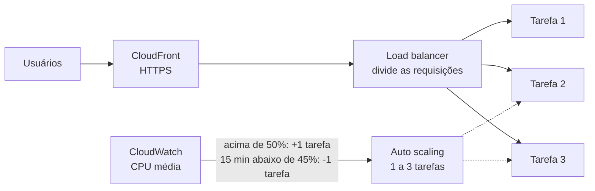

# Escalabilidade e custo — o balanceamento funcionou? Quanto custa crescer?

| Item | Valor |
|---|---|
| Data | 09/11/2026 (testes na AWS em 05 e 06/11/2026) |
| Ambiente | AWS us-east-1: CloudFront → Application Load Balancer → ECS Fargate Spot (tarefas de 0,25 vCPU e 512 MB, auto scaling de 1 a 3 pela CPU com alvo de 50%) → MongoDB Atlas M0 e S3 |
| Evidências | Pasta [`relatorios/`](.): [`escalabilidade-aws-2026-11-06.json`](escalabilidade-aws-2026-11-06.json), [`carga-aws-pos-correcao-2026-11-05/`](carga-aws-pos-correcao-2026-11-05), [`capacidade-consultas-local-2026-11-09.json`](capacidade-consultas-local-2026-11-09.json) |

## 1. Resposta curta

**Sim, o balanceamento e o auto scaling funcionaram.**

- Com a carga, a AWS subiu sozinha de **1 para 3 tarefas**, e o load balancer passou a dividir as requisições entre elas.
- Sem carga, voltou sozinha para **1 tarefa**, cerca de 20 minutos depois.
- Depois de corrigir um defeito de conexão (seção 3), a taxa de erro ficou em **0%**.
- **Ressalva:** na última rodada a carga não ficou igual entre as 3 tarefas. A melhoria proposta está na seção 4.

**Custo para crescer** (estimativa da seção 5; os preços são referências públicas aproximadas):

| Pacientes cadastrados | Custo por mês | Custo por paciente por mês | Custo por 1 milhão de requisições |
|---|---|---|---|
| Demonstração (hoje) | ~R$ 170 se ficar ligada 24 h (~R$ 0,23/h) | — | — |
| 100 mil | ~R$ 600 | R$ 0,006 | ~R$ 300 |
| **1 milhão** | **~R$ 2.800** (otimizado: ~R$ 1.450) | **R$ 0,003** | **~R$ 140** |
| 10 milhões | ~R$ 13.000 | R$ 0,0013 | ~R$ 65 |

Quanto mais gente usa, **mais barato fica por pessoa**: a parte fixa (load balancer, banco) se divide entre mais usuários.

## 2. Como o balanceamento funciona

- O **load balancer** recebe todas as requisições e distribui entre as tarefas saudáveis. Ele só manda para a tarefa que responde ao `/api/health/live`.
- O **auto scaling** olha a CPU média a cada minuto. Passou de 50%, sobe mais uma tarefa (até 3). Ficou 15 minutos abaixo de 45%, desce uma.
- Uma tarefa nova leva **cerca de 1,5 minuto** para ficar pronta.

## 3. Resultados dos testes na AWS

Carga: 20 usuários fazendo login sem parar. O login é a operação mais pesada da API, porque o bcrypt gasta CPU de propósito para proteger as senhas.

| Rodada | Quando | Versão da API | C02: 1 tarefa (5 min) | C03: auto scaling (10 min) | Tarefas | Erros |
|---|---|---|---|---|---|---|
| 1 | 05/11, 22:58 | Sem a correção | 2,8 req/s · p95 9,6 s | 6,0 req/s · p95 6,2 s | 1 → 3 → 1 | **1,65% / 1,09%** (502) |
| 2 | 05/11, 23:45 | **Com a correção** | 2,8 req/s · p95 8,9 s | 4,7 req/s · p50 1,7 s · p95 9,1 s | 1 → 3 → 1 | **0% / 0%** |
| 3 | 06/11, 01:13 | Sem a correção (outro deploy) | 2,9 req/s · p95 9,9 s | 5,9 req/s · p95 6,8 s | 1 → 3 → 1 | **3,14% / 1,21%** (502) |

Linha do tempo do auto scaling (horário de Brasília):

| Rodada | Subiu para 2 | Subiu para 3 | Fim da carga | Desceu para 2 | Voltou para 1 |
|---|---|---|---|---|---|
| 1 | 23:04 | 23:10 | 23:13 | 23:31 | 23:34 |
| 2 | 23:51 | 23:57 | 00:00 | 00:21 | 00:24 |

**O que os números mostram**

1. **Escala de verdade.** Na rodada 1, com 3 tarefas no fim da carga, a vazão chegou a **8,4 logins/s**. É 3 vezes a de 1 tarefa (2,8/s), ou seja, crescimento linear.
2. **Defeito encontrado e corrigido.** Os erros 502 vinham do próprio load balancer; a API não registrou nenhum erro.
   - **Causa:** o Node fechava conexões paradas em 5 s, e o load balancer as reaproveitava por até 60 s.
   - **Correção:** a API agora segura a conexão por 65 s.
   - **Prova:** a rodada 2, com a correção, teve **0 erros em 3.659 requisições**. A rodada 3 usou um deploy sem a correção e os erros voltaram, o que confirma a causa.
3. **Monitoramento funcionou.** O alarme de lentidão (p95 acima de 2 s) mandou e-mail durante a carga e avisou de novo quando normalizou.

## 4. Ressalva: carga desigual entre as tarefas

Na rodada 2, com 3 tarefas:

- o tempo **típico** caiu de 7,3 s para **cerca de 1 s** (p50);
- mas os **5% mais lentos** continuaram perto de 8,5 s (p95);
- a CPU média ficou em 87%, e não em 100%.

**Leitura:** uma das tarefas recebeu mais trabalho que as outras e acumulou fila. O load balancer divide por número de requisições (*round robin*), mas um login demora muito mais que as outras requisições.

**Melhoria proposta (não aplicada):** trocar o algoritmo do load balancer para `least_outstanding_requests`, que manda cada requisição para a tarefa com menos trabalho pendente. É uma linha no `infra/lib/api-stack.ts`, e depois é só repetir o C03.

## 5. Quanto custa se chegar mais gente

### 5.1 Capacidade de uma tarefa (medida)

| Operação | 1 processo local (Ryzen 5 5600GT) | 1 tarefa na AWS (0,25 vCPU) |
|---|---|---|
| Login (bcrypt) | 16,9 req/s | **2,8 req/s** (medido) |
| Abrir prontuário (com auditoria) | 599 req/s | ~100 req/s (estimado) |
| Agenda do médico | 1.116 req/s | ~185 req/s (estimado) |
| Carteira digital (app) | 854 req/s | ~140 req/s (estimado) |
| Atendimentos do paciente (app) | 1.511 req/s | ~250 req/s (estimado) |

A coluna da AWS aplica a mesma proporção medida no login: 2,8 ÷ 16,9 = 0,17.

As consultas são **35 a 90 vezes mais leves que o login**. Para a estimativa:
- usei uma mistura de **5% logins e 95% consultas**, considerando todas as consultas tão pesadas quanto abrir o prontuário (cenário pessimista);
- isso dá cerca de **36 req/s por tarefa** com a CPU em 100%;
- com o alvo do auto scaling em 50%, sobram **~18 req/s por tarefa**.

### 5.2 Premissas de uso

| Premissa | Valor | Por quê |
|---|---|---|
| Requisições por paciente por mês | 20 | Abrir o app 2 vezes por mês (~6 requisições cada) mais as consultas do médico no atendimento |
| Horário de uso | 12 h por dia | Unidades de saúde e uso do app durante o dia |
| Pico | 3 vezes a média | Manhãs de segunda-feira, campanhas de vacinação |
| Documentos | 2 por paciente por ano, 300 KB cada | Receitas e laudos em PDF |
| Dólar | R$ 5,50 | — |

Pico de requisições por segundo = pacientes × 20 ÷ (30 dias × 12 h × 3.600 s) × 3.

| Pacientes | Requisições por mês | Pico | Tarefas necessárias |
|---|---|---|---|
| 100 mil | 2 milhões | 4,6 req/s | 2 (mínimo para alta disponibilidade) |
| 1 milhão | 20 milhões | 46 req/s | 2 a 5 (média de 3) |
| 10 milhões | 200 milhões | 463 req/s | 4 a 10 tarefas maiores (1 vCPU), média de 7 |

### 5.3 Custo mensal estimado (US$)

Os preços são referências públicas da AWS (us-east-1, sob demanda) e do MongoDB Atlas, aproximados em nov/2026: Fargate US$ 0,0123/h por tarefa de 0,25 vCPU, load balancer US$ 0,0225/h, IP público US$ 0,005/h, CloudFront América do Sul US$ 0,022 por 10 mil requisições acima do nível gratuito, S3 US$ 0,023/GB. **Antes de usar em proposta oficial, confira na [AWS Pricing Calculator](https://calculator.aws/) e na página de preços do Atlas.**

| Item | 100 mil | 1 milhão | 10 milhões |
|---|---|---|---|
| ECS Fargate, sob demanda (sem Spot, para não cair) | 18 | 27 | 252 |
| Load balancer | 17 | 18 | 24 |
| IPs públicos | 15 | 18 | 33 |
| CloudFront (10 milhões de requisições/mês grátis) | 0 | 22 | 418 |
| MongoDB Atlas | 58 (M10) | 394 (M30) | ~1.460 (M50) |
| S3 (documentos) | 2 | 16 | 160 |
| CloudWatch (logs, alarmes) | 1 | 3 | 15 |
| Redis (limite de login entre tarefas) | — | 12 | 23 |
| **Total por mês** | **~US$ 110 (R$ 600)** | **~US$ 510 (R$ 2.800)** | **~US$ 2.390 (R$ 13.100)** |
| Por paciente por mês | R$ 0,006 | R$ 0,003 | R$ 0,0013 |
| **Por 1 milhão de requisições** | **R$ 300** | **R$ 140** | **R$ 65** |

**Para comparar, a demonstração de hoje** (1 tarefa Spot e Atlas M0 gratuito) custa cerca de **US$ 0,042/h**: R$ 0,23 por hora, ou ~R$ 170 por mês se ficar ligada direto. Por isso ela só sobe para testes e apresentações.

### 5.4 Onde está o custo e como baixar (cenário de 1 milhão)

- **O banco é ~77% do custo.** O que mais ocupa espaço é a auditoria (cada acesso ao prontuário vira um registro).
  - Guardar os últimos 6 meses no Atlas e arquivar o resto no S3, que é ~10 vezes mais barato, permite usar o **M20 (~US$ 146)** em vez do M30.
  - O total cai para **~US$ 260/mês (~R$ 1.450)**.
- **Fargate Spot** em parte das tarefas (mantendo 2 sob demanda) economiza mais ~US$ 10.
- **CloudFront:** acima de dezenas de milhões de requisições, vale avaliar os planos de preço fixo do CloudFront.
- **Região São Paulo** (`sa-east-1`), recomendada pela LGPD em produção: computação e load balancer custam cerca de 30% a 50% a mais que na Virgínia.

### 5.5 O que muda na arquitetura para 1 milhão

| Hoje (demonstração) | Para 1 milhão | Motivo |
|---|---|---|
| Atlas M0 gratuito | M30 (ou M20 com arquivamento) | O M0 tem 512 MB e limite de ~100 operações/s |
| Fargate Spot, 1 a 3 tarefas | Sob demanda, 2 a 5 tarefas, em 2 zonas | Não pode cair numa interrupção do Spot |
| Limite de login na memória de cada tarefa | Redis compartilhado (ElastiCache) | Com 5 tarefas, o limite por tarefa vira 5 vezes maior |
| Round robin | `least_outstanding_requests` | Seção 4 |
| Auditoria sem prazo | 6 meses no banco, depois arquivo no S3 | Seção 5.4 |

O código da API não precisa mudar para crescer: só a configuração da infraestrutura em `infra/`, que já é código (AWS CDK).

## 6. Conclusão

- O **auto scaling e o load balancer funcionam**:
  - a API sobe e desce sozinha conforme a carga;
  - a vazão cresce na proporção do número de tarefas;
  - depois da correção do keep-alive, os erros foram zero.
- **O ponto de melhoria** é a distribuição desigual da carga entre as tarefas. Ela tem solução simples (seção 4) e ainda precisa ser testada.
- **Para 1 milhão de pacientes, a estimativa é de ~R$ 2.800 por mês** (~R$ 1.450 com as otimizações): menos de **R$ 0,003 por paciente por mês**, ou **~R$ 140 por milhão de requisições**. O maior custo é o banco de dados, não os servidores da API.
